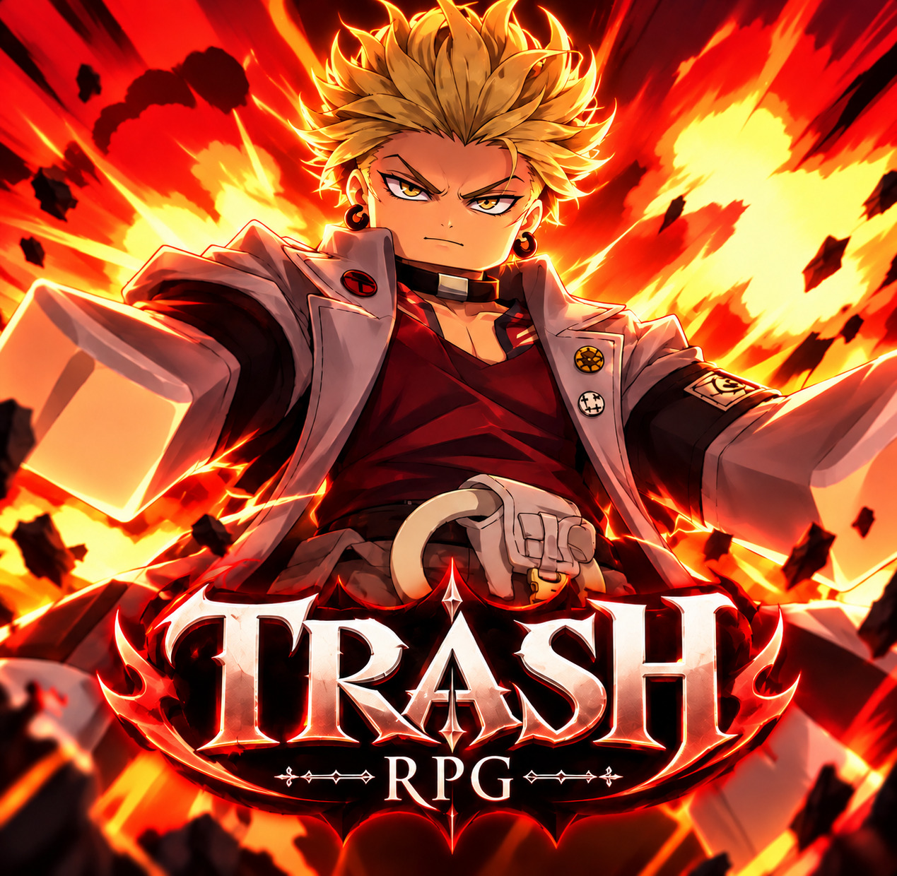
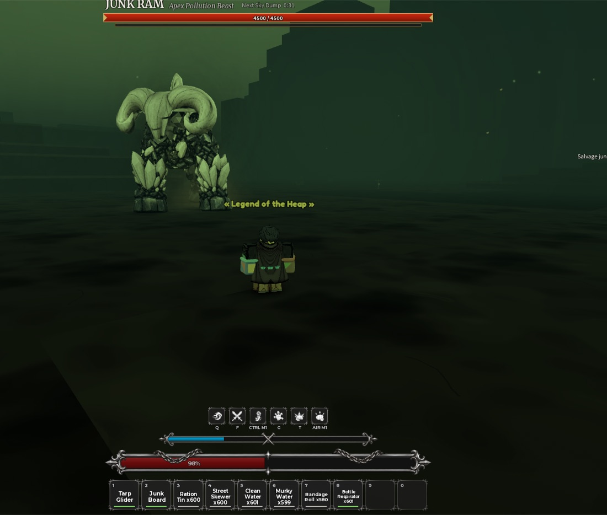

# TRASH



**Play it on Roblox:** https://www.roblox.com/games/139363873869909/TRASH



An original Roblox action RPG, built in Luau, about a year in development. It is inspired by an anime I love, with an original world, factions, and systems. I submitted it to the Congressional App Challenge.

Showcase video: https://youtu.be/wf2Kc4tQBTo

## Idea

Players live in the Heap, a community below a city that discards its waste onto the people beneath it. The game asks where a thrown-away object actually goes and who bears the cost. The environmental theme is part of play, not an info page added at the end.

## What players do

- Explore, salvage, and complete quests, then turn discarded objects into upgradeable Relics such as umbrellas, sandals, hubcaps, and push brooms.
- Fight pollution-themed creatures (including the Junk Ram) and other players, with combos, dodges, parries, and special abilities.
- Join one of two factions, the Menders or the Scrappers, which respond differently to scarcity. Four skill paths, faction ranks, quests, and persistent profiles give the game a longer arc.
- Read unlockable Field Notes in the Journal, which connect the game's world to real-world actions such as repair and reducing disposable plastic.

## Shared pollution

Pollution is a server-wide condition. Sorting and purification lower it. Smelting, abandoned waste, and destruction raise it. Higher pollution speeds hunger and thirst loss and increases Smogling spawns, while cleaner conditions improve salvage yields. One player's short-term gain can affect everyone sharing the air. The system is simplified so consequences are easy to see in play. It is not a scientific model.

## Technical problems I worked through

- **Combat input and networking:** repeated inputs needed debouncing and cooldowns while keeping controls responsive. The client gives immediate feedback and the server checks state, range, timing, and cooldowns before applying damage or rewards.
- **Animation:** missing asset IDs and scripts running in the wrong place caused failures, so I traced each bug from input to handler to animation to visible result.
- **Destruction:** a knocked-back character could hit a wall before the server detected movement. The fix used active knockback velocity and a short look-ahead check, with limited temporary debris on clients.
- **Sound:** effects were too loud and a preload bug treated sound IDs as images.
- **Blender:** a 3D model generated with Tripo AI had gaps and looked poor. I taught myself Blender to repair and animate it.

## My role, and AI tools

I am the creator and director: I chose the premise, audience, environmental connection, priorities, and feedback. I used AI tools (Claude and OpenAI Codex) extensively for Luau code generation and revision, debugging, and automated checks, and Tripo AI for 3D assets. AI agents did significant implementation work, so I do not claim to have written every line myself. My friends tested the game, gathered resources, found problems, and helped me when I was stuck.

## Source code

The Luau source for the whole game is in this repository: 221 scripts (server, client and shared modules) exported from the place file, organized the way Roblox Studio shows them.

```
src/
  ServerScriptService/   combat, mobs, destruction, progression (server logic)
  ReplicatedStorage/     shared data, remotes, client controllers, UI
  StarterPlayer/         character scripts, shift lock, player scripts
  StarterGui/            HUD scripts
  ServerStorage/         map generation tools and data
  Workspace/             scripts attached to the rig and the train system
combat-prototype/        a newer server-authoritative combat backend with 167 tests
default.project.json     Rojo project file for the services above
```

To read the code, just open the `src` folders. To sync it into Studio, install [Rojo](https://rojo.space) and run `rojo serve` here. The world itself (terrain, models, meshes, audio and animation assets) is not in this repository. It lives in the Roblox place, so the code alone will not recreate the full game.

The scripts were exported unchanged from the version 566 place (the top image is the game's cover art, and the second is an in-game screenshot). As described above, AI tools wrote much of this code. I directed the design, tested it and fixed problems.

`combat-prototype` is an isolated rewrite of the combat rules (attacks, parry, posture, dodge, launch) that I built and tested in a separate copy of the place. It has not been published to the live game.

## Status

In development. Ideas for version 2.0, not yet built: player interviews, clearer onboarding, more active repair and reuse goals, stronger sources for Field Notes, accessibility improvements, and more multiplayer and save/rejoin testing.
